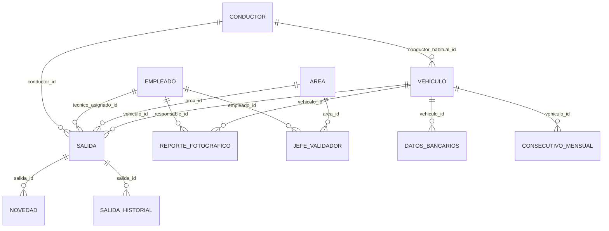
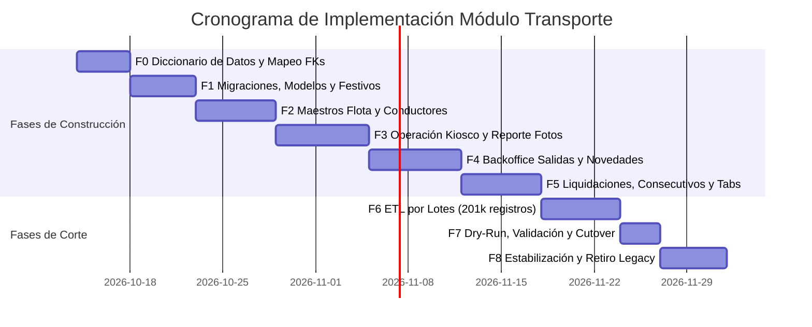

# Plan Técnico de Migración e Implementación: Módulo de Transporte
**De PHP Legacy ("Cinco") a Django / Ecosistema ADMCINCO**  
**Fecha:** 13 de Octubre de 2026  
**Versión:** 2.0 (Definitiva y Consolidada)  
**Estado:** Documento de Especificación Técnica y Plan de Ejecución  

---

## 1. Resumen Ejecutivo y Diagnóstico Global

El presente documento define la hoja de ruta técnica para la modernización y migración integral del subsistema de **Transporte** del software corporativo **"Cinco"** hacia la arquitectura modular en **Django**.

### Diagnóstico de la Deuda Técnica Heredada
El módulo opera actualmente a través de scripts PHP monolíticos fuertemente acoplados ([`base_salida_transporte.php`](file:///c:/Users/admin/Documents/funcionalidades%20genericas/MIGRACIONES/base_salida_transporte.php), [`transporte_salida.php`](file:///c:/Users/admin/Documents/funcionalidades%20genericas/MIGRACIONES/transporte_salida.php), [`base_transportadores.php`](file:///c:/Users/admin/Documents/funcionalidades%20genericas/MIGRACIONES/base_transportadores.php) y componentes como [`transporte_reporte_vehiculo_inc.php`](file:///c:/Users/admin/Documents/funcionalidades%20genericas/MIGRACIONES/transporte_reporte_vehiculo_inc.php)):
1. **Triplicidad de Reglas:** Reglas de validación dispersas e inconsistentes entre scripts PHP, controladores AJAX, funciones en JavaScript (`moment.js`) y consultas SQL directas.
2. **Ausencia de Integridad Referencial:** Cédulas almacenadas como cadenas de texto heterogéneas (`varchar(50)`, `varchar(20)`, `int`), valores centinela (`'disponible'`, `'0'`), claves foráneas inexistentes e inyección SQL generalizada.
3. **Persistencia Híbrida en JSON:** Datos bancarios, liquidaciones, novedades y trazabilidad histórica almacenados como cadenas JSON dentro de campos de texto (`longtext`), lo que impide indexación y auditoría eficiente.
4. **Volumen de Datos Actual:** Aproximadamente **~1.246 vehículos**, **~108 conductores externos** y **~201.000 salidas transaccionales**.

### Principios Rectores de la Nueva Arquitectura
* **Construcción en Paralelo + Corte Único (*Cutover*):** El módulo actual en PHP continúa operando sin alteración alguna. El nuevo módulo en Django se construye y valida en paralelo. La transición se realizará en una ventana de corte planificada con capacidad de *rollback* inmediato (menos de 2 minutos vía puntero de menú).
* **Adopción Estricta de `ID Foreign Keys`:** Todas las relaciones entre entidades (Conductores, Vehículos, Empleados, Áreas, Sedes) se implementan mediante llaves foráneas formales sobre IDs enteros autoincrementales con índices optimizados.
* **Separación de Conductores Externos vs. Empleados de Nómina:** Muchos conductores son transportistas independientes o terceros que **no existen en la base corporativa de personal**. Se modelan como una entidad autónoma (`Conductor`), separada de la entidad de personal corporativo (`Empleado`).
* **Capa de Servicios Única (`services.py`):** Ninguna vista ni endpoint contendrá lógica de negocio; toda regla dura residirá exclusivamente en servicios testeables.

---

## 2. Mapa Completo de Módulos y Funcionalidades en Alcance

```
                                  ECOSISTEMA TRANSPORTE COMPLETO
 ┌───────────────────────────────────────────────┬───────────────────────────────────────────────┐
 │            OPERACIÓN Y CAPTURA                │             ADMINISTRACIÓN Y PAGOS            │
 ├───────────────────────────────────────────────┼───────────────────────────────────────────────┤
 │ 1. ABM Flota Vehicular                        │ 4. Gestión de Salidas (Tab 1)                 │
 │    (base_transportadores.php)                 │    (base_salida_transporte.php)               │
 │    - Ficha de vehículo, SOAT/CDA, fotos, QR   │    - Aprobación / Rechazo masivo              │
 │ 2. Catálogo de Conductores Externos           │    - Novedades y ventana -2 días hábiles      │
 │    (transporte_base_conductores.php)          │ 5. Sábana de Informes y Nómina (Tab 2)        │
 │    - Licencias, vigencias, vinculación        │    (transporte_salida_informes.php)           │
 │ 3. Registro Operativo de Salidas              │ 6. Liquidaciones Financieras (Tab 3)          │
 │    (transporte_salida.php)                    │    (transporte_salida_datos.php)              │
 │    - Modo tablet/kiosco QR                    │    - Pago Mensual, Pronto Pago y consecutivos │
 │    - Control anticolisión (vehículo/móvil)    │ 7. Planilla Oficial de Salida                 │
 │ 4. Reporte Fotográfico de Vehículos           │    (planilla_salida.php)                      │
 │    (transporte_reporte_vehiculo_inc.php)      │    - Consecutivo auditable y formato físico   │
 │    - Validación agenda en Operaciones (10a-4p)│                                               │
 └───────────────────────────────────────────────┴───────────────────────────────────────────────┘
```

---

## 3. Matriz de Módulos y Reglas de Negocio a Preservar

### 3.1. Maestro de Flota Vehicular ([`base_transportadores.php`](file:///c:/Users/admin/Documents/funcionalidades%20genericas/MIGRACIONES/base_transportadores.php))
* **Catálogo:** Marca, modelo, año, cilindraje, color, tipo de contrato (`PROPIO`, `EXTERNO`, `RENTING`), estado (`ACTIVO`/`INACTIVO`).
* **Semáforo Documental de SOAT y CDA:** Cálculo determinista en servidor de los días de vigencia:
  * $> 60$ días: Verde (Vigente).
  * $31 - 60$ días: Naranja (Por vencer).
  * $\le 30$ días o vencido: Rojo (Crítico / No operable).
* **Gestión Documental y Fotográfica:** Almacenamiento validado de imágenes en storage controlado (`media/transporte/vehiculos/`), eliminando rutas relativas en texto plano.
* **Datos Bancarios:** Normalización del JSON legacy hacia la entidad relacional `DatosBancariosVehiculo` (banco, tipo de cuenta, número, titular).

### 3.2. Catálogo de Conductores Externos ([`transporte_base_conductores.php`](file:///c:/Users/admin/Documents/funcionalidades%20genericas/MIGRACIONES/transporte_base_conductores.php))
* **Independencia de Nómina:** Registro de transportadores externos que no existen en `cinco_base_de_personal`.
* **Licencia de Conducción:** Control estricto de número, categoría y fecha de vencimiento.
* **Cruce de Teléfonos:** Búsqueda en cascada: (1) Teléfono del catálogo de conductores externos $\rightarrow$ (2) Línea corporativa asignada en telecomunicaciones (`nokia_base_lineas`) $\rightarrow$ (3) Teléfono personal (si coincide con personal interno).

### 3.3. Registro Operativo de Salidas ([`transporte_salida.php`](file:///c:/Users/admin/Documents/funcionalidades%20genericas/MIGRACIONES/transporte_salida.php))
* **Restricción Anticolisión Doble:**
  1. `UniqueConstraint(vehiculo, fecha_salida)`: Un vehículo no puede registrar más de una salida en la misma fecha.
  2. `UniqueConstraint(conductor, fecha_salida)`: Un conductor externo no puede figurar en más de una salida activa el mismo día.
* **Modalidad "Disponible" (Sin tripulación):**
  * Si el vehículo sale sin personal, el sistema exige de forma obligatoria la selección de un **Área** responsable.
* **Ventana de Creación:** Restricción a fecha actual y máximo **2 días hábiles hacia atrás** (excluyendo fines de semana y festivos oficiales de Colombia).

### 3.4. Backoffice de Gestión y Liquidaciones ([`base_salida_transporte.php`](file:///c:/Users/admin/Documents/funcionalidades%20genericas/MIGRACIONES/base_salida_transporte.php))
* **Tab 1: Gestión Diaria de Salidas:**
  * Aprobación masiva por lotes (`save_valid_transport`) filtrada por el área del validador.
  * Rechazo obligatorio con motivo (`rechazar_salida`), concatenando trazabilidad y registrando fila en `SalidaHistorial`.
  * Novedades (adicionales / descuentos) que impactan directamente el valor a liquidar.
  * Borrado lógico (`estado = 'ELIMINADO'`).
* **Tab 2: Sábana de Informes y Nómina ([`transporte_salida_informes.php`](file:///c:/Users/admin/Documents/funcionalidades%20genericas/MIGRACIONES/transporte_salida_informes.php)):**
  * Filtros multidimensionales (rango de fechas, estados, sedes, áreas).
  * Conciliación y exportación masiva a Excel/CSV.
* **Tab 3: Liquidaciones Financieras ([`transporte_salida_datos.php`](file:///c:/Users/admin/Documents/funcionalidades%20genericas/MIGRACIONES/transporte_salida_datos.php)):**
  * Sábana de **Pago Mensual** (`tb_vehiculos_pago_mensual`): `(días trabajados * valor_dia) ± novedades`.
  * Sábana de **Pronto Pago** (`tb_vehiculos_pronto_pago`).
  * Generación atómica de **Consecutivos Mensuales** (`consecutivos_mensuales`) bajo transacción pesimista (`select_for_update()`).
  * Parametrización de fechas límite de cierre mensual y matriz de Jefes Validadores.

### 3.5. Reporte Fotográfico Diario ([`transporte_reporte_vehiculo_inc.php`](file:///c:/Users/admin/Documents/funcionalidades%20genericas/MIGRACIONES/transporte_reporte_vehiculo_inc.php))
* **Validación de Agenda en Operaciones:** El responsable del vehículo **debe tener agenda programada hoy en `operaciones_agenda`** (salvo áreas expresamente exentas).
* **Ventana Horaria de Captura:** La toma de evidencia está habilitada exclusivamente entre las **10:00 a.m. y las 4:00 p.m.** (hora Colombia).
* **Compresión y Evidencia:** Captura desde dispositivo móvil, compresión optimizada vía `Pillow` (~500–800 KB) y almacenamiento con metadatos de auditoría y OT/Actividad asociada.

### 3.6. Planilla Oficial de Salida ([`planilla_salida.php`](file:///c:/Users/admin/Documents/funcionalidades%20genericas/MIGRACIONES/planilla_salida.php))
* Formato estandarizado de despacho para patio con código QR de verificación, consecutivo mensual correlativo y detalle de tripulación y equipos.

---

## 4. Diseño del Modelo de Datos (Relacional con `ID Foreign Keys`)



### Modelos de Dominio en Django (`apps/transporte/models/`)

#### A. Conductor Externo ([`conductor.py`](file:///c:/Users/admin/Documents/app-cinco/backend/apps/transporte/models/conductor.py))
```python
class Conductor(AuditableModel):
    cedula = models.CharField(max_length=20, unique=True, db_index=True)
    nombre_completo = models.CharField(max_length=150)
    celular = models.CharField(max_length=30)
    direccion = models.CharField(max_length=150, blank=True, null=True)
    barrio = models.CharField(max_length=100, blank=True, null=True)
    licencia_numero = models.CharField(max_length=50, blank=True, null=True)
    licencia_categoria = models.CharField(max_length=10, blank=True, null=True)
    licencia_vencimiento = models.DateField(blank=True, null=True)
    tipo_vinculacion = models.CharField(max_length=50, default='EXTERNO')
    fecha_ingreso = models.DateField(blank=True, null=True)
    fecha_egreso = models.DateField(blank=True, null=True)
    fecha_nacimiento = models.DateField(blank=True, null=True)
    activo = models.BooleanField(default=True, db_index=True)

    class Meta:
        db_table = 'transporte_conductor'
```

#### B. Vehículo ([`vehiculo.py`](file:///c:/Users/admin/Documents/app-cinco/backend/apps/transporte/models/vehiculo.py))
```python
class Vehiculo(AuditableModel):
    placa = models.CharField(max_length=10, unique=True, db_index=True)
    tipo_vehiculo = models.CharField(max_length=50)
    marca = models.CharField(max_length=50)
    referencia = models.CharField(max_length=50, blank=True, null=True)
    modelo = models.PositiveSmallIntegerField() # Año
    color = models.CharField(max_length=40, blank=True, null=True)
    municipio = models.CharField(max_length=60, blank=True, null=True)
    tipo_contrato = models.CharField(max_length=30) # PROPIO, EXTERNO, RENTING
    conductor_habitual = models.ForeignKey(
        Conductor, on_delete=models.SET_NULL, null=True, blank=True, related_name='vehiculos_asignados'
    )
    nombre_propietario = models.CharField(max_length=150)
    cedula_propietario = models.CharField(max_length=20)
    celular_propietario = models.CharField(max_length=30, blank=True, null=True)
    fecha_soat = models.DateField(null=True, blank=True)
    fecha_cda = models.DateField(null=True, blank=True)
    valor_dia_base = models.DecimalField(max_digits=12, decimal_places=2, default=0.0)
    activo = models.BooleanField(default=True, db_index=True)

    class Meta:
        db_table = 'transporte_vehiculo'
```

#### C. Salida ([`salida.py`](file:///c:/Users/admin/Documents/app-cinco/backend/apps/transporte/models/salida.py))
```python
class Salida(AuditableModel):
    vehiculo = models.ForeignKey(Vehiculo, on_delete=models.PROTECT, related_name='salidas')
    fecha_salida = models.DateField(db_index=True)
    conductor = models.ForeignKey(
        Conductor, on_delete=models.PROTECT, null=True, blank=True, related_name='salidas'
    )
    tecnico_asignado = models.ForeignKey(
        'empleados.Empleado', on_delete=models.PROTECT, null=True, blank=True, related_name='salidas_responsable'
    )
    es_disponible = models.BooleanField(default=False)
    area = models.ForeignKey('common.Area', on_delete=models.PROTECT, related_name='salidas_transporte')
    carpeta = models.CharField(max_length=100, blank=True, null=True)
    sede = models.CharField(max_length=100, blank=True, null=True)
    valor_dia = models.DecimalField(max_digits=12, decimal_places=2) # Tarifa inmutable snapshot
    estado = models.CharField(max_length=20, choices=EstadoSalida.choices, default=EstadoSalida.REPORTADO, db_index=True)
    observacion = models.TextField(blank=True, null=True)

    class Meta:
        db_table = 'transporte_salida'
        constraints = [
            models.UniqueConstraint(fields=['vehiculo', 'fecha_salida'], name='uq_salida_vehiculo_fecha'),
            models.UniqueConstraint(
                fields=['conductor', 'fecha_salida'],
                condition=models.Q(conductor__isnull=False),
                name='uq_salida_conductor_fecha'
            ),
        ]
        indexes = [
            models.Index(fields=['fecha_salida', 'estado']),
            models.Index(fields=['area', 'fecha_salida']),
        ]
```

#### D. Reporte Fotográfico ([`reporte_fotografico.py`](file:///c:/Users/admin/Documents/app-cinco/backend/apps/transporte/models/reporte_fotografico.py))
```python
class ReporteFotograficoVehiculo(AuditableModel):
    vehiculo = models.ForeignKey(Vehiculo, on_delete=models.PROTECT, related_name='reportes_fotos')
    responsable = models.ForeignKey('empleados.Empleado', on_delete=models.PROTECT, related_name='reportes_fotos_creados')
    fecha = models.DateField(db_index=True)
    hora = models.TimeField()
    ot_actividad = models.CharField(max_length=100, blank=True, null=True)
    imagen = models.ImageField(upload_to='transporte/reportes_diarios/%Y/%m/%d/')
    observaciones = models.TextField(blank=True, null=True)

    class Meta:
        db_table = 'transporte_reporte_fotografico'
        constraints = [
            models.UniqueConstraint(fields=['vehiculo', 'fecha'], name='uq_reporte_foto_vehiculo_dia')
        ]
```

#### E. Consecutivo Mensual ([`liquidacion.py`](file:///c:/Users/admin/Documents/app-cinco/backend/apps/transporte/models/liquidacion.py))
```python
class ConsecutivoMensual(models.Model):
    vehiculo = models.ForeignKey(Vehiculo, on_delete=models.PROTECT, related_name='consecutivos')
    mes = models.PositiveSmallIntegerField()
    anio = models.PositiveSmallIntegerField()
    consecutivo = models.PositiveIntegerField()

    class Meta:
        db_table = 'transporte_consecutivo_mensual'
        constraints = [
            models.UniqueConstraint(fields=['vehiculo', 'mes', 'anio'], name='uq_consecutivo_vehiculo_periodo')
        ]
```

---

## 5. Arquitectura de Servicios de Negocio (`services.py`)

Siguiendo el contrato arquitectónico de ADMCINCO (**`ViewSet -> Service -> Serializer`**):

1. **`SalidaService`:**
   * `validar_regla_dos_dias(fecha_salida, usuario)`: Valida la fecha contra la tabla de festivos en caché y verifica permisos de bypass.
   * `registrar_salida(datos_validados, actor)`: Bloqueo transaccional atómico, verificación de constraints e inserción de snapshot de tarifa.
   * `aprobar_masivo(ids_salidas, usuario)`: Valida que el actor sea jefe validador de cada área involucrada y actualiza en bloque.
   * `rechazar(id_salida, motivo, usuario)`: Exige motivo obligatorio y registra en `SalidaHistorial`.
2. **`LiquidacionService`:**
   * `procesar_pago_mensual(mes, anio)`: Consulta agregada de salidas aprobadas y cálculo de novedades para liquidación.
   * `procesar_pronto_pago(mes, anio)`: Liquidación bajo modalidad anticipada.
   * `obtener_o_generar_consecutivo(vehiculo_id, mes, anio)`: Transacción atómica con `select_for_update()` para asegurar correlativo continuo sin duplicados.
3. **`ReporteFotograficoService`:**
   * `validar_agenda_responsable(empleado_id, fecha)`: Consulta en `operaciones_agenda` para verificar si el responsable tiene agenda habilitada.
   * `validar_horario_captura(hora)`: Asegura que la captura ocurra en el intervalo habilitado (10:00 a 16:00).
   * `guardar_evidencia(vehiculo_id, empleado_id, imagen_file, ot)`: Compresión y guardado en almacenamiento estructurado.

---

## 6. Fases del Plan de Implementación y Cronograma



### Detalle de Fases de Ejecución

| Fase | Alcance y Entregables Técnicos | Criterio de Aceptación / Salida |
| :--- | :--- | :--- |
| **F0 — Diccionario y Mapeo FKs** | Mapeo de columnas legacy a nuevos modelos. Diccionario para desambiguar cédulas de conductores externos vs empleados. | Especificación de base de datos cerrada y aprobada. |
| **F1 — Base Django y Festivos** | Esquema en MySQL `utf8mb4`. Precarga del calendario de festivos de Colombia con caché en memoria. Pruebas de la regla de -2 días. | Migraciones ejecutadas limpiamente y tests de fecha 100% pasando. |
| **F2 — Flota y Conductores** | ABM de Vehículos (`base_transportadores`), semáforo documental y datos bancarios. Catálogo autónomo de Conductores externos. | CRUD operativo con validación de licencias y documentos. |
| **F3 — Operación Kiosco y Fotos** | Registro diario de salidas (`transporte_salida.php`) con QR/tablet. Reporte fotográfico diario validando agenda (10a-4p). | Despacho operativo y captura de evidencias operando en paralelo. |
| **F4 — Backoffice y Novedades** | Tab 1 de `base_salida_transporte.php`: Aprobación masiva, rechazo con motivo, eliminación lógica y novedades. | Coordinadores y jefes gestionan salidas diarias en Django. |
| **F5 — Liquidaciones e Informes** | Tabs 2 y 3 de `base_salida_transporte.php`: Pago Mensual, Pronto Pago, consecutivos mensuales atómicos y planilla oficial. | Cierre mensual y liquidaciones reproducibles idénticas a PHP. |
| **F6 — ETL de Migración Histórica** | Comando `manage.py migrate_transporte_legacy`: Carga por lotes de 2.000 registros, resolución de `ID Foreign Keys` y desempaquetado de JSONs. | 201.000 registros migrados con discrepancia de conciliación = 0. |
| **F7 — Cutover Único y Pase de Puntero** | Dry-run en ambiente de pruebas. Ventana de corte en producción: congelación de escrituras legacy, sincronización final y redirección de menú. | Producción activa en Django. PHP intacto como plan de respaldo. |
| **F8 — Estabilización** | Monitoreo de consultas e índices en MySQL. Archivo del código PHP legacy. | Cierre formal del proyecto. |

---

## 7. Plan de Pruebas y Validación de Regresión

1. **Conductores Externos vs Empleados:**
   * Registrar conductor externo cuya cédula no exista en personal corporativo $\rightarrow$ El sistema debe permitirlo fluidamente.
   * Emitir salida asociando vehículo y conductor externo $\rightarrow$ Integridad referencial (`FK`) garantizada sin errores.
2. **Restricción de Fechas y Festivos de Colombia:**
   * Registro con fecha futura $\rightarrow$ Rechazo inmediato.
   * Registro con fecha anterior a 2 días hábiles (saltando puentes y domingos) $\rightarrow$ Rechazo para usuarios estándar; permitido para administradores autorizados.
3. **Aprobación Masiva y Jerarquía:**
   * Aprobación masiva de 50 salidas en lote $\rightarrow$ Transición a `APROBADO` sin bloqueos de concurrencia.
   * Intento de aprobación por jefe de otra área $\rightarrow$ Denegado por permisos de dominio.
4. **Liquidaciones Financieras y Consecutivos:**
   * Emisión concurrente de consecutivos mensuales para el mismo vehículo $\rightarrow$ Secuencia correlativa sin colisiones ni duplicados.
   * Comparación de totales liquidados en el mes entre PHP y Django $\rightarrow$ Discrepancia = **\$0 pesos**.
5. **Reporte Fotográfico:**
   * Captura fuera del rango 10:00 a 16:00 $\rightarrow$ Bloqueo por horario.
   * Captura con responsable sin agenda en `operaciones_agenda` $\rightarrow$ Bloqueo por falta de programación.

---

## 8. Estrategia de Seguridad y Contingencia (Rollback)

* **Regla de Oro:** Ningún archivo ni ruta preexistente en PHP (`controller_cinco.php`, `base_salida_transporte.php`, etc.) será alterado durante el desarrollo.
* **Seguridad Estricta en Base de Datos:**
  * Uso obligatorio del ORM de Django con consultas parametrizadas.
  * Prohibido ejecutar sentencias destructivas en producción sin autorización explícita.
* **Rollback Inmediato:**
  * El código PHP legacy permanecerá intacto en el servidor de producción.
  * En caso de contingencia imprevista tras el corte, revertir al sistema PHP requiere únicamente reasignar la URL en la tabla de menú (`config_menu`), tardando **menos de 2 minutos** y con cero pérdida de operatividad.
